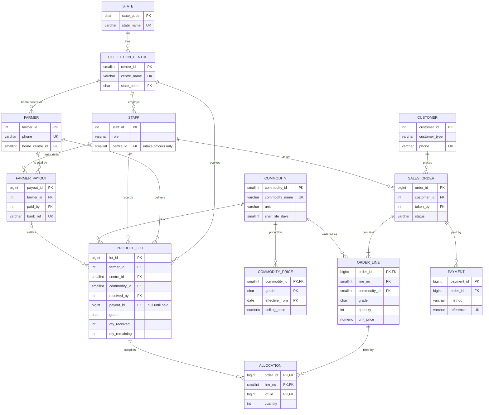

# ER diagram

The diagram is written in Mermaid so it renders on GitHub. A PNG copy is in
`er-diagram.png`. Only keys and the columns that matter for relationships are shown;
the full column list is in `schema.sql`.

## Notes on the relationships

- **Order line to lot is many-to-many.** One order line for 40 crates of grade A tomatoes
  might be filled from three farmers' lots, and one large lot can be split across many
  orders. `allocation` sits between them and records how much of each lot went to each
  line. Following order line to allocation to lot to farmer is how an order is traced
  back to the farms it came from.
- **Payout to lot is optional on the lot side.** A lot has no payout until finance pays
  the farmer, so `produce_lot.payout_id` is nullable. A composite foreign key on
  `(payout_id, farmer_id)` stops a lot being settled through another farmer's payout.
- **Staff to lot.** The receiving officer must be an intake officer at the same centre as
  the lot. This is enforced with a composite foreign key on `(received_by, centre_id)`
  rather than a trigger.
- **Sales order to order line is one-to-many with at least one line** (`||--|{`). The
  database cannot force "at least one" with a plain constraint, so the application
  inserts the order and its lines in one transaction (covered in Portfolio 3).
- **Commodity price** is a weak entity: it only exists for a commodity, and its key
  includes the commodity, grade and the date the price took effect.
